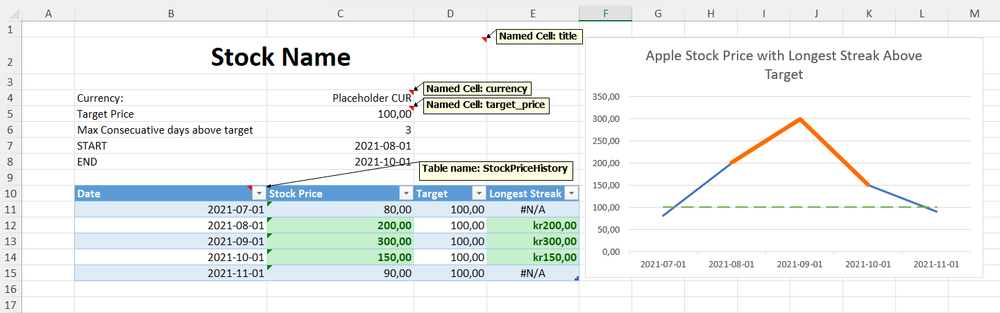
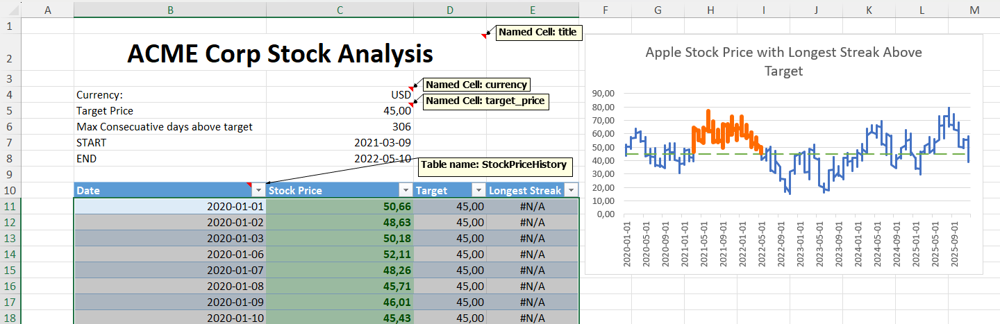

# fillxl

**Fill Excel templates with data from Python.**

Designed around named cells and Excel tables — no more fragile cell references like `A1` or `B3`. Charts, formulas, formatting, and conditional formatting are preserved and updated automatically. Fill tables using plain lists, pandas, polars, or duckdb.

## Installation

```bash
pip install fillxl
```

Optional extras:

```bash
pip install fillxl[pandas]   # pandas support
pip install fillxl[all]      # pandas + polars + duckdb
```

## Quick Start

1. In Excel, create **named cells** (Name Manager) for single values and **Excel Tables** (`Ctrl + T`) for tabular data.
2. Fill the template — tables are automatically resized, charts updated, and formatting preserved.

### Choosing a backend

```python
fill(..., engine="openpyxl")   # default, cross-platform
fill(..., engine="win32com")   # Windows + Excel (maximum fidelity)
```

## Visual Example

**Before filling:**



```python
from fillxl import fill
import pandas as pd
import numpy as np

# Generate some fake stock data
dates = pd.date_range("2020-01-01", "2025-12-31", freq="B")
rng = np.random.default_rng(42)
prices = (50 + np.cumsum(rng.normal(0.05, 2.0, len(dates)))).clip(5).round(2)
stock_data = pd.DataFrame({"Date": dates, "Stock Price": prices})

fill(
    template="stock_template.xlsx",
    output="stock_filled.xlsx",
    tables={"StockPriceHistory": stock_data},
    values={
        "title": "ACME Corp Stock Analysis",
        "currency": "USD",
        "target_price": 45,
    },
    engine="win32com"
)
```

**After filling:**



**Note that the *Target* and *Longest Streak* columns are formulas, and they are automatically updated to extend with the table.**

## Features

- Populate named cells and Excel tables
- Automatic table resizing + chart range updates
- Conditional formatting and pivot table refresh
- Two backends: `openpyxl` (default) and `win32com` (Windows + Excel)
- Supports list, dict, pandas, polars, and duckdb data

## Supported Data Sources

| Format | Example |
|--------|---------|
| `list[dict]` | `[{"Name": "A", "Price": 10}]` |
| `dict[str, list]` | `{"Name": ["A", "B"], "Price": [10, 20]}` |
| `pandas.DataFrame` | `pd.read_csv("data.csv")` |
| `polars.DataFrame` | `pl.read_csv("data.csv")` |
| `duckdb.DuckDBPyRelation` | `duckdb.sql("FROM 'data.csv'")` |

## Performance

Benchmark: **5,000 rows × 20 columns** (list[dict] data).

| Method | Engine | Time (mean ± std) |
|--------|--------|-------------------|
| `fillxl` | openpyxl | 2.26s ± 0.03s |
| `fillxl` | win32com | 2.80s ± 0.03s |
| `pandas.to_excel` | openpyxl | 3.01s ± 0.09s |

## Project Status

The project is currently at `0.x` to allow early adopters to evaluate the package. Once it has been stable in the wild for a while, the version will be bumped to `1.0` to signal production readiness.

!!! info "Community-driven"
    No new features are planned — the roadmap is purely driven by community feedback and contributions.