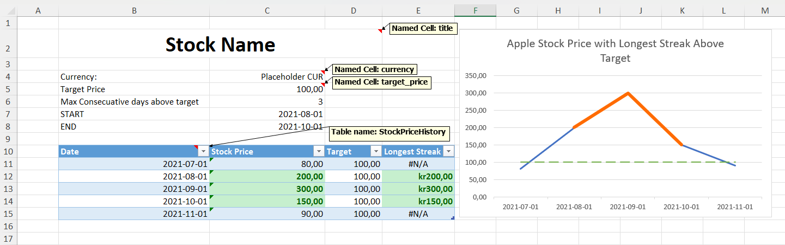
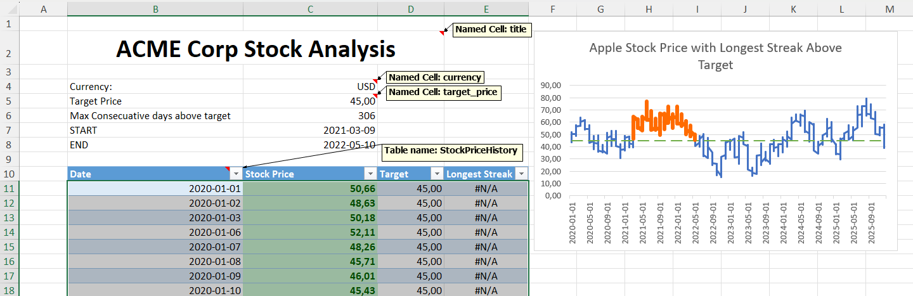

# fillxl

**Fill Excel templates with data from Python.**

Designed around named cells and Excel tables — no more fragile cell references like `A1` or `B3`. Charts, formulas, formatting, and conditional formatting are preserved and updated automatically. Fill tables using plain lists, pandas, polars, or duckdb.

## Installation

```bash
pip install fillxl
```

There is nothing else to choose. Tables can come from plain Python (`list[dict]`,
`dict[str, list]`) or from pandas, Polars and DuckDB objects that your own code
creates; fillxl detects the type of whatever you pass and never imports a data
library itself, so a library you already use works as it is:

```python
import pandas as pd
from fillxl import fill

fill(..., tables={"Sales": pd.read_csv("sales.csv")})
```

## Quick Start

1. In Excel, create **named cells** (Name Manager) for single values and **Excel Tables** (`Ctrl + T`) for tabular data.
2. Fill the template — tables are automatically resized, charts updated, and formatting preserved.

### Choosing an engine

```python
fill(..., engine="auto")       # default: openpyxl unless Excel is needed
fill(..., engine="openpyxl")   # cross-platform, no Excel needed
fill(..., engine="fillxl")     # keeps everything, no Excel, no model
fill(..., engine="win32com")   # Windows + Excel (maximum fidelity)
```

`"auto"` uses openpyxl for `.xlsx`/`.xlsm` templates saved in the same format,
and Excel when it is needed (`.xlsb`/`.xls` templates, format conversion) and
available. `"fillxl"` is opt-in and experimental; [The fillxl
engine](fillxl-engine.md) describes what it does. Every engine writes the same
values for the same template and data; [Backends](backends.md) lists what still
differs.

## Visual Example

**Before filling:**



```python
from fillxl import fill
import pandas as pd
import numpy as np

# Generate some fake stock data
dates = pd.date_range("2020-01-01", "2025-12-31", freq="B")
rng = np.random.default_rng(42)
prices = (50 + np.cumsum(rng.normal(0.05, 2.0, len(dates)))).clip(5).round(2)
stock_data = pd.DataFrame({"Date": dates, "Stock Price": prices})

fill(
    template="stock_template.xlsx",
    output="stock_filled.xlsx",
    tables={"StockPriceHistory": stock_data},
    values={
        "title": "ACME Corp Stock Analysis",
        "currency": "USD",
        "target_price": 45,
    },
    engine="win32com"
)
```

**After filling:**



**Note that the *Target* and *Longest Streak* columns are formulas, and they are automatically updated to extend with the table.**

## Features

- Populate named cells and Excel tables
- Automatic table resizing + chart range updates
- Calculated columns and formulas that track the table stay in step with it
- Conditional formatting and pivot table refresh
- Three backends: `openpyxl` (default), `fillxl` (keeps spilled arrays and
  other parts openpyxl cannot write, still no Excel) and `win32com` (Windows +
  Excel)
- Dates, sheets and warnings behave the same in every engine
- Supports list, dict, pandas, polars, and duckdb data

## Supported Data Sources

| Format | Example |
|--------|---------|
| `list[dict]` | `[{"Name": "A", "Price": 10}]` |
| `dict[str, list]` | `{"Name": ["A", "B"], "Price": [10, 20]}` |
| `pandas.DataFrame` | `pd.read_csv("data.csv")` |
| `polars.DataFrame` | `pl.read_csv("data.csv")` |
| `duckdb.DuckDBPyRelation` | `duckdb.sql("FROM 'data.csv'")` |

## Performance

fillxl is a thin layer over openpyxl (or over Excel itself), so fill time is
dominated by the engine: expect a few seconds for tens of thousands of cells
and minutes for hundreds of thousands. `engine="fillxl"` is the fastest of the
three, at roughly twice the speed of `openpyxl` for the same workbook.

[Benchmarks](benchmarks.md) shows the published numbers and how to reproduce
them with `scripts/benchmark.py` on your own machine, template and data.

## Project Status

The project is currently at `0.x` to allow early adopters to evaluate the package. Once it has been stable in the wild for a while, the version will be bumped to `1.0` to signal production readiness.

!!! info "Community-driven"
    No new features are planned — the roadmap is purely driven by community feedback and contributions.